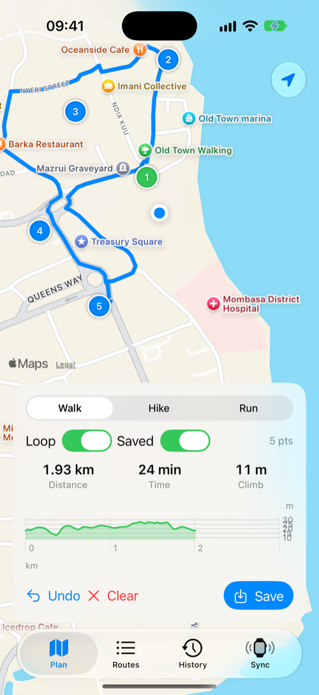
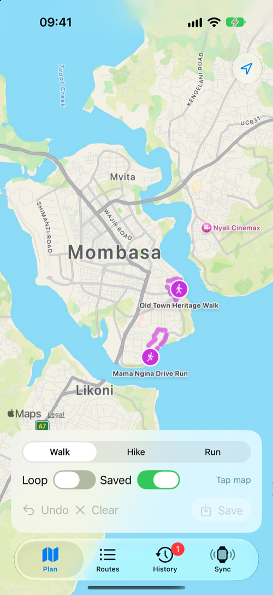
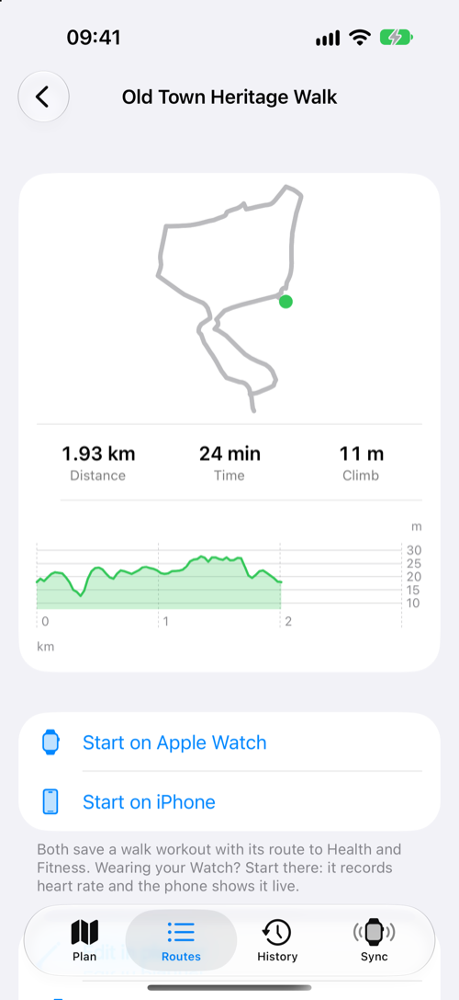
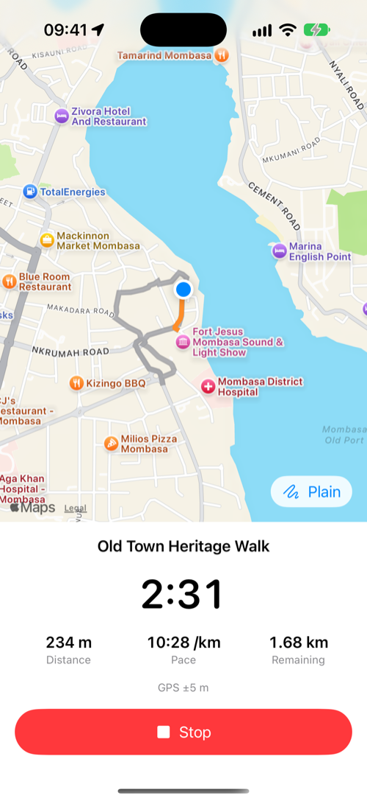
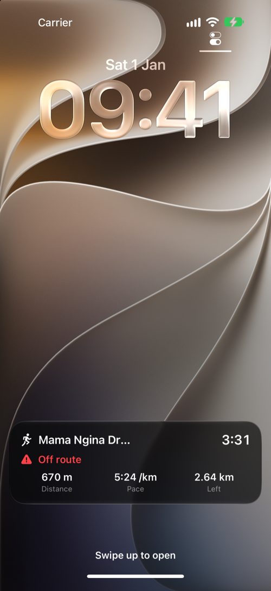
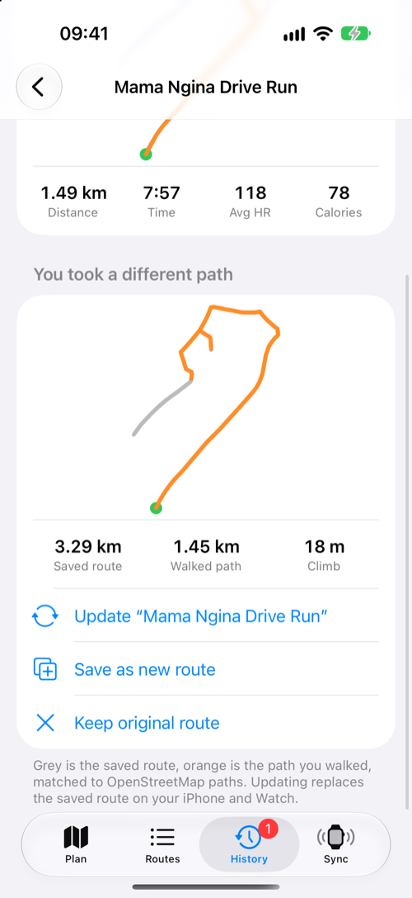
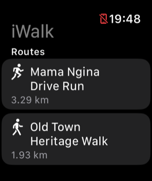
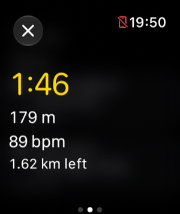
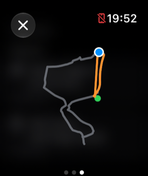

# iWalk

Plan a walk, hike or run on your iPhone while online, then follow it, record it and sync it with **no internet**, on the iPhone, the Apple Watch, or both. Workouts are saved to Apple Health and appear in Fitness with their route map. Route planning uses a self-hosted [Valhalla](https://github.com/valhalla/valhalla) server built from OpenStreetMap data for Kenya.

**Status:** prototype, built and field-tested in Mombasa with a free Apple developer account.

## Screenshots

Demo routes around Fort Jesus, Old Town and Mama Ngina Drive in Mombasa.

**Plan while online**

<table>
  <tr>
    <td align="center"><br><sub>Plan a walk, hike or run</sub></td>
    <td align="center"><br><sub>Saved routes on the map</sub></td>
    <td align="center"><br><sub>Start on Apple Watch or iPhone</sub></td>
  </tr>
</table>

**Follow it offline**

<table>
  <tr>
    <td align="center"><br><sub>Live tracking</sub></td>
    <td align="center"><br><sub>Live Activity with off-route alert</sub></td>
    <td align="center"><br><sub>Took a different path? Update the route</sub></td>
  </tr>
</table>

**Apple Watch**

<table>
  <tr>
    <td align="center"><br><sub>Synced routes</sub></td>
    <td align="center"><br><sub>Workout with heart rate</sub></td>
    <td align="center"><br><sub>Route view, no map tiles needed</sub></td>
  </tr>
</table>

## Features

- **Plan routes on a map** with walk, hike or run costing, distance, time and an elevation profile. Saved routes are shown on the map.
- **Follow routes offline** on iPhone or Apple Watch, with live stats, off-route alerts, a Live Activity on the lock screen, and a plain route view when map tiles aren't available.
- **Start on Apple Watch from the iPhone.** The Watch records the workout (with heart rate) and the phone shows it live. You can also start a walk without a route on either device.
- **Phone ↔ Watch sync** over Bluetooth or local Wi-Fi: routes go to the Watch, finished walks come back to the phone.
- **Routes learn from your walks.** If you walked a different path, iWalk offers to update the saved route. A walk without a plan is saved as a new route once you're online.

## Requirements

- A Mac with Xcode 27 and [Homebrew](https://brew.sh)
- An iPhone on iOS 18 or later, and optionally an Apple Watch on watchOS 11 or later
- A free Apple ID (Personal Team) signed in to Xcode
- A VPS for the routing server: Ubuntu 24.04, 2 vCPU, 4 GB RAM, 40 GB disk, with ports 80 and 443 open

## Installation

1. Clone the repository:
   ```bash
   git clone https://github.com/achingachris/iWalk.git && cd iWalk
   ```
2. Deploy the routing server on your VPS by following [docs/deploy-server.md](docs/deploy-server.md). At the end you get a base URL and an API key.
3. Install XcodeGen and create your local config, which is git-ignored:
   ```bash
   brew install xcodegen
   ```
   ```bash
   cp ios/Config/Local.xcconfig.example ios/Config/Local.xcconfig
   ```
   Then set these values in `ios/Config/Local.xcconfig`:
   - `DEVELOPMENT_TEAM`: your Personal Team ID.
   - `BUNDLE_PREFIX`: pick one and never change it.
   - `IWALK_BASE_URL`: write it as `https:/$()/your-host`, because `//` starts a comment in xcconfig.
   - `IWALK_API_KEY`: the key from your server.
4. Generate the Xcode project and open it:
   ```bash
   cd ios && xcodegen generate && open iWalk.xcodeproj
   ```
5. In Xcode, sign in under **Settings → Accounts**. Then pair your iPhone and Apple Watch in **Device Hub** (**Xcode → Open Developer Tool → Device Hub**), and run the `iWalk` scheme on the iPhone. The Watch app is included.
6. On first launch, trust your developer profile on the iPhone: **Settings → General → VPN & Device Management**.

## Usage

- **Plan:** tap the map to add points, drag a point to move it, or long-press it and choose **Delete point**. Pick Walk, Hike or Run, then tap **Save**. Planning needs internet.
- **Routes:** open a saved route and tap **Start on Apple Watch** or **Start on iPhone**. Or tap **▶** to start a walk, hike or run without a route.
- **History:** your walks, other walking, hiking and running workouts from Health, and route suggestions after walks that took a different path.
- **Sync:** phone ↔ Watch connection status, route versions and pending transfers.

Apps installed with a free Apple ID stop opening after **7 days**. Run them from Xcode again to renew; your routes and history are kept.

## Project layout

| Path | What it is |
|---|---|
| `ios/` | iPhone app, Watch app, Live Activity widget and the shared `iWalkCore` Swift package. See [ios/README.md](ios/README.md) |
| `server/` | Valhalla behind Caddy (HTTPS and a shared-key check), deployed with Docker Compose. See [server/README.md](server/README.md) |
| `docs/` | [Deployment guide](docs/deploy-server.md), [field-test checklist](docs/field-test.md) and a sample route response |
