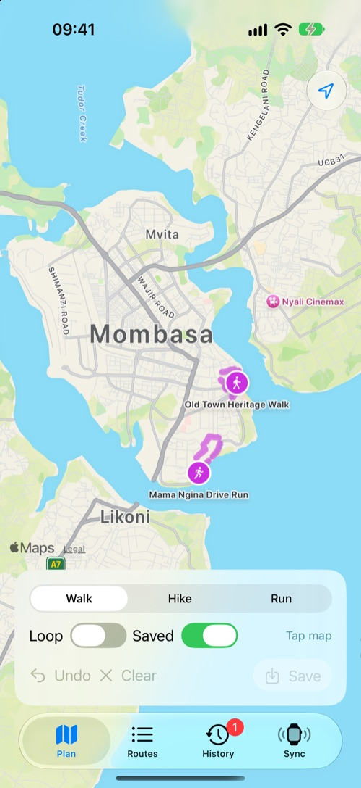
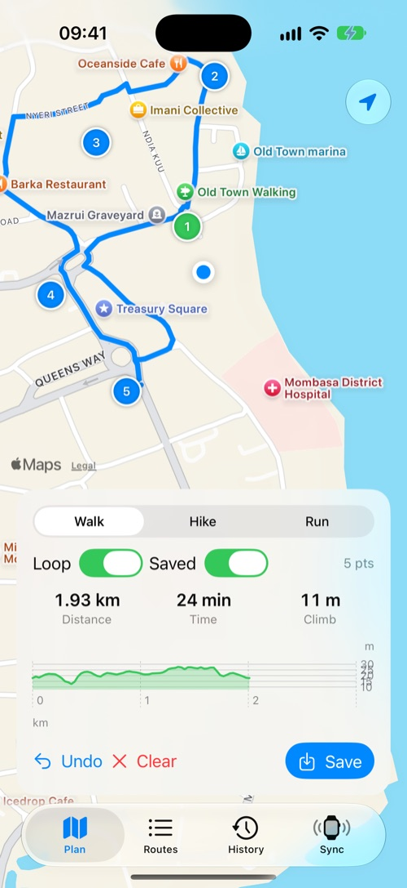
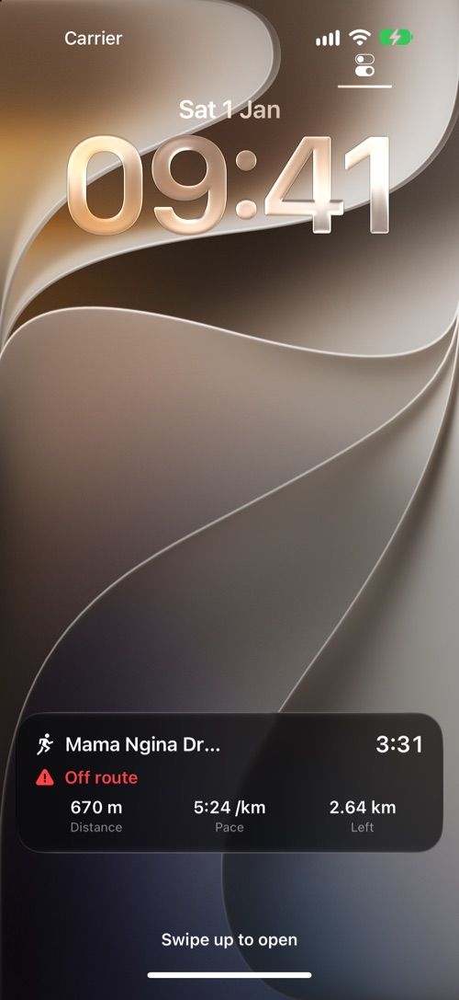
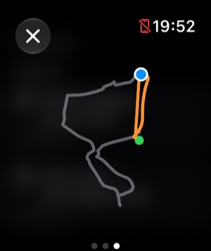
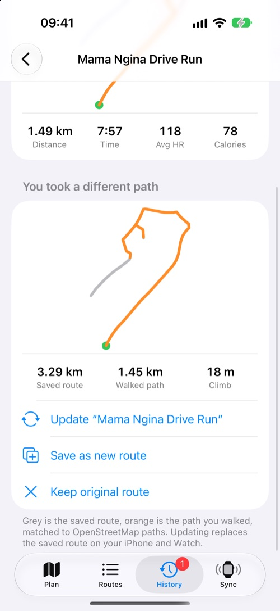

I like exploring Mombasa on foot, and the best walks are often the ones where my phone is least useful: narrow Old Town streets where GPS jumps around, the seafront along Mama Ngina Drive, and trails like Shimba Hills where there is simply no signal. I wanted an app that lets me plan a route at home, on Wi-Fi, and then forget about the internet completely once I step outside. So I built one. It is called iWalk, and this post explains what it does, how it works, and what a real 10 km test walk taught me.

## what is iWalk?

iWalk is an iPhone and Apple Watch app for planning and following walks, hikes and runs. The idea fits in one line: **plan online, use offline.**

- **Plan on a map.** Tap points, pick Walk, Hike or Run, and get a route with distance, time, total climb and an elevation profile.
- **Follow it with no internet.** Live stats, a lock screen Live Activity, and a buzz when you wander more than 30 m off the route.
- **Record on the iPhone or the Watch.** Workouts land in Apple Health and Fitness with their route map, and the Watch records heart rate.
- **Sync over Bluetooth.** Routes go to the Watch and finished walks come back to the phone, no mobile data needed.
- **Learn from your walks.** If you took a different path, iWalk offers to update the saved route. A walk with no plan becomes a new route.

*Planning a loop through Old Town. The elevation comes from the same server that builds the route.*

## to a non-technical person, what is iWalk?

Think of it as drawing your walk on a paper map before you leave the house, except the map knows which streets and footpaths exist and how hilly they are. Once the route is drawn, your phone and your watch keep a copy, so they can guide you even when you have no network at all. When you get home, it tells you how the walk went and, if you improvised a better path, it offers to remember that instead.

*The lock screen keeps updating during a walk, including the off-route warning.*

## how it works

The first surprise came early: Apple Maps has **no walking directions in Mombasa**. Asking it for a route returns "Walking Directions Not Available". So routing comes from [Valhalla](https://github.com/valhalla/valhalla), an open source routing engine, running on a small VPS (virtual private server). It is built from the [OpenStreetMap](https://www.openstreetmap.org) extract for Kenya, with elevation data, and sits behind [Caddy](https://caddyserver.com), which handles HTTPS and only lets through requests that carry a shared key.

Planning is the only step that needs the server. Everything you need afterwards, the route line, its distance and its elevation profile, is saved on the device with the route. From there:

- **SwiftData** stores routes and walks on the iPhone and the Watch.
- **WatchConnectivity** sends routes to the Watch and finished walks back, over Bluetooth or local Wi-Fi.
- **HealthKit** records the workout, its route and heart rate, so it shows up in Fitness like any other walk.
- **ActivityKit** powers the Live Activity, updated by the app itself, so no push server is needed.

The whole prototype runs on a free Apple developer account. That means no push notifications, no iCloud, and apps that expire after seven days until you reinstall them, so the design leans on local storage and device-to-device sync.

*On the Watch there are no map tiles, just the route, your track and where you are.*

## the 10 km field test

I planned a 10.68 km walk and recorded it on the Watch. Health recorded **10.71 km in about two hours**, within 0.3% of the plan. The Watch logged a GPS fix every two seconds with a median accuracy of 4 m, and the walk synced back to the phone over Bluetooth and showed up in Fitness with its route.

The data also exposed a few things worth fixing:

- **The walk was not linked to its route.** I started it from the Watch without picking the route, so iWalk saved it as a brand-new, near-identical route. Now a free walk that mostly follows a saved route is treated as a walk of that route.
- **GPS wobble adds distance.** Summing every 2 m step of the raw track gave 10.94 km, about 2% too long. Ignoring steps under 5 m brought it to 10.74 km, within 0.2% of Health.
- **I took a different path for about 2.9 km.** That is exactly the case the route review is built for: after the walk, iWalk matches your track to real paths and offers Update route, Save as new route, or Keep original.

*Took a detour? iWalk asks before changing anything.*

Two smaller lessons came from building it. On the iPhone, Apple's live workout builder needs iOS 26, so on older versions the Watch sends its live stats to the phone itself. And matching a GPS track to OpenStreetMap needs a generous search radius when the track wanders off the mapped streets; with the defaults, a 519 m simulated test track matched to just 8 m.

## what's next

The next step is the rest of the field-test list: Fort Jesus to Old Town, a run on Mama Ngina Drive, Nyali Beach, Haller Park, and Shimba Hills, where the real test is trails that are missing from OpenStreetMap. Where a path is missing, the fix is to add it to OpenStreetMap and rebuild the server, which also helps everyone else who uses that data.

The code, the server setup and the field-test checklist are on GitHub: [achingachris/iWalk](https://github.com/achingachris/iWalk).

---

*Written and Authored by Chris, Edited and assisted by Claude*
